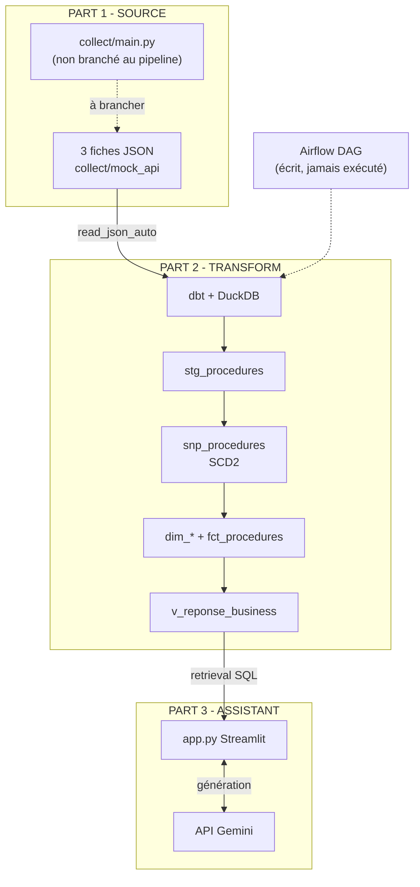
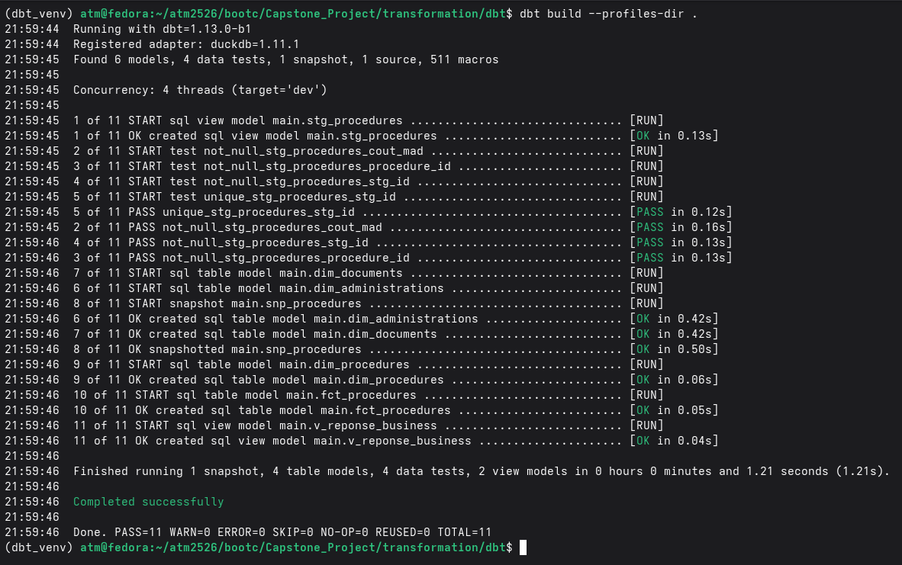
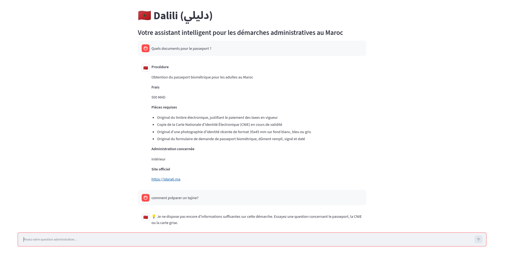

# Dalili (دليلي) : pipeline de données et assistant RAG pour les démarches administratives marocaines

Dalili est un projet capstone qui combine un pipeline Data Engineering et un assistant conversationnel. Il aide les citoyens à savoir quels documents préparer, combien ça coûte et où déposer le dossier pour trois démarches : le passeport biométrique, la CNIE et le transfert de carte grise.

> **Statut : MVP.** Le but est de prouver que la chaîne fonctionne (modélisation en étoile, historisation, assistant) sur un petit périmètre. Plusieurs exigences du cahier des charges ne sont pas encore remplies : elles sont listées dans les sections 3 et 4. Ce n'est pas encore un service prêt pour le public. La section 8 décrit les prochaines étapes envisagées (évaluation, cloud, MCP).

---

## 1. Source de données et pourquoi je l'ai choisie

Les données concernent le portail officiel **Idarati.ma**, la référence nationale des procédures administratives (loi 55-19 sur la simplification des procédures). Je l'ai choisi pour trois raisons :

- **Utile et officiel** : c'est la liste de référence, donc l'assistant peut s'appuyer sur une source qu'on peut citer.
- **Assez riche pour un schéma en étoile** : une démarche est liée à une administration, a des frais, un délai et une liste de pièces à fournir. On a un fait et plusieurs dimensions, pas une table à plat.
- **Des valeurs qui peuvent changer** : les frais (par exemple le timbre du passeport) et les délais évoluent avec les textes, ce qui donne du sens à un snapshot SCD2.

**Important : il n'y a pas de collecte automatique depuis Idarati.** Les 3 fichiers JSON (`passeport.json`, `cnie.json`, `carte_grise.json`) reprennent le contenu des fiches Idarati, ils sont stockés dans `collect/mock_api/` et ne sont pas récupérés par une requête vers le site. Leurs valeurs (frais, délais, pièces) doivent être vérifiées sur Idarati avant tout usage réel.

---

## 2. Architecture

Schéma de ce qui est réellement livré :



### Cible GCP et version livrée

L'architecture cible du cours est GCS + BigQuery, et les fichiers Terraform (`terraform/`) décrivent cette cible : bucket landing, datasets BigQuery, service account. Au déploiement, la création des ressources a été bloquée par une erreur de facturation du compte d'essai :

```
AccessDeniedException: 403 The billing account for the owning project is disabled in state absent
```

J'ai donc tout exécuté en local, avec **DuckDB** (`dbt-duckdb`) à la place de BigQuery. Les modèles SQL dbt, le snapshot et les tests sont les mêmes, seule la couche de stockage change. Les fichiers Terraform n'ont pas été appliqués sur un vrai projet GCP.

---

## 3. Où j'en suis par rapport aux exigences

| Exigence                                                       | État                                                                   |
| -------------------------------------------------------------- | ---------------------------------------------------------------------- |
| Données de sources réelles                                     | Partiel : contenu de fiches Idarati en JSON, sans collecte automatique |
| Landing d'un fichier brut par run                              | **Pas fait** (dbt lit directement les JSON)                            |
| Pipeline idempotent et incrémental                             | **Pas fait**                                                           |
| Couche curated typée                                           | Fait : `stg_procedures`                                                |
| Étoile : 1 fait + au moins 3 dimensions                        | Fait : `fct_procedures` + 3 dimensions                                 |
| SCD2                                                           | Exécuté une fois, aucun changement de tarif encore observé             |
| Tests `unique` / `not_null`                                    | Fait : 4 tests, tous au vert                                           |
| Tests `relationships`, `accepted_values`, singulier, freshness | **Pas fait**                                                           |
| 3 à 5 questions métier                                         | Partiel : une vue globale, pas de modèles séparés                      |
| Orchestration (DAG)                                            | DAG écrit, jamais exécuté                                              |
| Infrastructure as code                                         | Terraform écrit, non appliqué                                          |
| Secrets exclus du dépôt                                        | Fait (`.gitignore`)                                                    |

---

## 4. Détail

### Ce qui fonctionne

- **Modélisation en étoile** : `stg_procedures`, `dim_procedures`, `dim_documents`, `dim_administrations`, `fct_procedures` (frais en MAD, délais en jours) et la vue `v_reponse_business`. Tout compile et s'exécute.
- **SCD Type 2** : `snp_procedures` est configuré pour suivre les frais et les délais. Il a été lancé sur les 3 fiches, mais comme rien n'a changé entre deux exécutions, il ne contient qu'une version par démarche pour l'instant.
- **Tests dbt** : `unique` sur `stg_id`, `not_null` sur `stg_id`, `procedure_id` et `cout_mad`.
- **Assistant** : interface Streamlit connectée au fichier DuckDB. Elle récupère le contexte dans `v_reponse_business` (retrieval SQL par mots-clés) puis l'envoie à un modèle Gemini Flash-Lite, avec la clé en variable d'environnement.

### Ce qui manque

- **Collecte** : pas de requête vers Idarati, pas de landing horodaté par run, pas de hash-and-compare. Relancer le pipeline ne détecte donc aucune donnée en double ou modifiée.
- **Orchestration** : le DAG (`transformation/dags/dalili_pipeline_dag.py`) n'a jamais tourné sur un serveur Airflow. Le pipeline a été lancé à la main :
  ```bash
  dbt run --select stg_procedures && dbt snapshot && dbt run
  ```
- **Tests avancés** : pas de `relationships` du fait vers chaque dimension, pas de `accepted_values`, pas de test SQL singulier (le dossier `tests/` est vide), pas de `dbt source freshness`.
- **Questions métier** : le dossier `analyses/` est vide, il manque 3 à 5 modèles avec la question posée en commentaire.
- **Cloud** : ni GCS ni BigQuery, à cause du blocage de facturation.

---

## 5. Installation et lancement

```bash
python -m venv .venv && source .venv/bin/activate
pip install dbt-duckdb streamlit google-genai
```

```bash
cd transformation/dbt
dbt run --select stg_procedures --profiles-dir .
dbt snapshot --profiles-dir .
dbt run --profiles-dir .
dbt test --profiles-dir .
cd ../..
```

```bash
export GEMINI_API_KEY="ma_cle"
streamlit run app.py
```

---

## 6. Sécurité et coût

- Le `.gitignore` exclut les secrets (`.env`, `gcp_key.json`), le fichier `.duckdb`, les dossiers `target/` et `logs/` de dbt, `data/landing/` ainsi que l'état et les variables Terraform. La clé Gemini passe par variable d'environnement, jamais dans le code.
- Aucune ressource cloud facturée n'est utilisée : tout tourne en local.

---

## 7. Limites du MVP

- **Échantillon de 3 démarches** : suffisant pour valider la mécanique du pipeline, pas pour un usage citoyen. Idarati en recense environ 2 700.
- **Données non récupérées automatiquement** : si Idarati change une fiche, le projet ne le voit pas.
- **Retrieval par mots-clés** : une question mal formulée, ou en darija, ne sera pas comprise.
- **Aucune évaluation chiffrée de l'assistant** : je n'ai pas mesuré sa fiabilité (voir 8.1).
- **L'assistant peut se tromper** : il faut toujours vérifier sur Idarati avant de déposer un dossier.
- **Pas d'historique réel des tarifs** : le snapshot SCD2 est en place mais n'a observé aucun changement.
- **Pas déployé** : l'application ne tourne qu'en local.

---

## 8. Pistes d'amélioration

### 8.1 Évaluer l'assistant

Pour l'instant je n'ai pas de mesure, seulement des essais à la main. L'étape suivante est de chiffrer la qualité, parce qu'un mauvais montant ou une pièce oubliée peut vraiment gêner quelqu'un.

**Jeu de test** : une trentaine de questions en français et en arabe, avec pour chacune la ou les démarches attendues et la réponse de référence, écrites à partir des fiches Idarati (frais, pièces, lieu de dépôt, délai).

| Partie     | Métrique         | Ce qu'elle mesure                                                                 |
| ---------- | ---------------- | --------------------------------------------------------------------------------- |
| Retrieval  | Precision@k      | Parmi les k éléments récupérés, quelle part est réellement pertinente             |
| Retrieval  | Recall@k         | Parmi tous les éléments pertinents, quelle part est retrouvée dans les k premiers |
| Génération | Faithfulness     | La réponse reste-t-elle fidèle au contexte récupéré, sans rien inventer           |
| Génération | Answer relevancy | La réponse répond-elle bien à la question posée                                   |

Les métriques de retrieval se calculent en comparant ce que la vue `v_reponse_business` renvoie avec les démarches attendues. Faithfulness et answer relevancy peuvent être notées par un LLM juge, avec un contrôle manuel d'un échantillon pour ne pas lui faire confiance aveuglément. Le tout tourne dans un script rejouable, ce qui permet de voir si un changement (nouveau retrieval, nouveaux embeddings) améliore ou dégrade les scores.

### 8.2 Passer du local au cloud

1. **Entrepôt** : DuckDB est un fichier local, or Cloud Run n'a pas de disque durable. Il faut passer à BigQuery avec `dbt-bigquery` (nouveau target dans `profiles.yml`) et appliquer le Terraform déjà écrit.
2. **Application** : conteneuriser Streamlit (`Dockerfile`), pousser l'image dans Artifact Registry et la déployer sur **Cloud Run**, avec la clé Gemini dans Secret Manager.
3. **Pipeline** : collecte et `dbt build` comme **Cloud Run Jobs**, déclenchés par Cloud Scheduler. Cloud Composer est possible mais coûte même à l'arrêt.
4. **CI/CD** : build et déploiement depuis GitHub, avec `dbt test` comme garde-fou avant chaque mise en ligne.

Cette étape demande un compte avec facturation activée, qui était justement le blocage de ce projet.

### 8.3 Exposer les données via un serveur MCP

Plutôt que de garder la logique dans une seule interface Streamlit, les données propres (les marts dbt) peuvent être exposées à n'importe quel assistant compatible **MCP**. Le serveur proposerait quelques outils :

- `rechercher_demarche(texte)` : retrouve une démarche à partir d'une question.
- `obtenir_pieces(demarche)` : liste des documents requis.
- `obtenir_frais_et_delai(demarche)` : montant en MAD et délai.
- `historique_frais(demarche)` : lecture du snapshot SCD2.

Chaque réponse renverrait la source officielle pour qu'elle puisse être citée. Le serveur peut aussi tourner sur Cloud Run, avec authentification et limite de débit avant toute ouverture au public.

### 8.4 Côté pipeline

- Collecte réelle depuis Idarati, dans le respect de ses conditions d'utilisation, avec landing horodaté et hash-and-compare.
- Exécution réelle du DAG Airflow.
- Tests dbt complets et `dbt source freshness`.
- 3 à 5 modèles de questions métier dédiés.
- Extension à l'ensemble des procédures d'Idarati.
- Retrieval vectoriel (embeddings multilingues) pour les questions approximatives et le darija.

---

## 9. Preuves d'exécution




